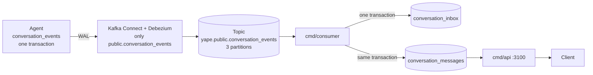

# ms-ml-conv-history-bs

Conversation history for the Yape assistant. It receives the agent's conversation events from
Kafka (published by Debezium), keeps every one in an inbox, projects the chat between the
user and the assistant into a history table, and serves that history over a small HTTP API
shaped after the Smooch message.

PoC for AIP-472. The API has no authentication, so this service must not be deployed.



| Binary | Role | Port |
|--------|------|------|
| `cmd/consumer` | Kafka -> inbox -> chat messages. `consumer rebuild` recreates the messages from the inbox | none |
| `cmd/api` | Reads the history | `3100` |

## Run

Both binaries read `config.yaml` from the working directory, so start them from the repo root.

```bash
make migrations/up        # create the tables (the testing repo owns the SQL)
go run ./cmd/consumer     # read the topic; stop with Ctrl-C (SIGTERM)
go run ./cmd/api          # serve on :3100
go run ./cmd/consumer rebuild
```

The same, detached, with logs and a start check, as in the agent repo (`scripts/`):

```bash
./scripts/run_api.sh                 # builds bin/api if stale, starts it in the background, waits for /health
./scripts/run_consumer.sh            # the same for the consumer; waits for its "consuming ..." line
./scripts/run_consumer.sh --replay   # consumer rebuild: recreate the chat messages from the inbox
./scripts/stop_api.sh
./scripts/stop_consumer.sh           # SIGTERM, so it logs its totals and commits its last offset
```

Both run scripts take `--rebuild` (force a build), `--foreground` and `--no-kill` (refuse to replace a
running instance); `run_api.sh` also takes `--port`. They work from any directory, stop a previous
instance first, and exit at once, with the log path, when the binary dies (a wrong config, an unreachable
database). Logs go to `scripts/logs/` and the consumer's pid to `scripts/logs/consumer.pid`; both are
gitignored. `check-conventions.sh` in the same folder is tracked.

Needs the local cluster (`../cluster`: Postgres with `wal_level=logical`, Kafka, Kafka Connect)
and the connector registered from `../ms-ml-genai-agents-bs/local/debezium/register.sh`.
`local/README.md` has the end-to-end steps.

## API

```bash
curl -s "localhost:3100/v1/conversations?idYapeAccount=<account>"
curl -s "localhost:3100/v1/conversations/<conversationId>/messages"
curl -sg "localhost:3100/v1/conversations/<conversationId>/messages?page[before]=<_id>"
curl -s  localhost:3100/health
```

| Route | Answer |
|-------|--------|
| `GET /v1/conversations/{conversationId}/messages` | up to 100 messages, oldest first; `page[before]` or `page[after]` (one at most) take a message `_id` |
| `GET /v1/conversations?idYapeAccount=` | the account's latest 100 conversations with chat messages, newest first |
| `GET /health` | `200` when the database answers, `503` otherwise |

The contract is `docs/ms-ml-conv-history-bs-openapi.yml` (Swagger 2.0), generated from the swag annotations
in `cmd/api/main.go` and the handlers, as in `cpgs-clg-core`: `make openapi` regenerates it and
`make openapi/check` fails when it is stale. A test fails when a served route is not documented, and
another when a reply carries a field the spec does not describe.

Errors: `400` for a malformed id, both cursors, or a cursor that is not a message of that
conversation; `404` for a conversation with no chat messages. `docs/design.md` has the reply
shape and the paging rule.

## Configuration

`config.yaml` expands `${VAR:-default}`; a local `.env` (git-ignored) can set the variables.

| Variable | Default |
|----------|---------|
| `SERVER_PORT` | `3100` |
| `POSTGRES_DSN` | empty; when set it wins over the fields below |
| `POSTGRES_HOST`, `POSTGRES_PORT`, `POSTGRES_USER`, `POSTGRES_PASSWORD`, `POSTGRES_DB` | `localhost`, `5432`, `postgres`, empty, `postgres` |
| `POSTGRES_SSL_MODE` | `disable` |
| `POSTGRES_MAX_CONNS`, `POSTGRES_MIN_CONNS` | `10`, `2` |
| `POSTGRES_CONN_MAX_LIFETIME`, `POSTGRES_CONN_MAX_IDLE_TIME`, `POSTGRES_CONNECT_TIMEOUT` | `3600`, `300`, `10` (seconds) |
| `KAFKA_CLIENT_BROKERS` | `localhost:9092` |
| `KAFKA_CLIENT_SASL_KEY`, `KAFKA_CLIENT_SASL_SECRET` | empty; both set turn on SASL over TLS |
| `KAFKA_TOPIC_EVENTS` | `yape.public.conversation_events` |
| `KAFKA_GROUP_ID` | `ms-ml-conv-history-bs` |
| `KAFKA_AUTO_OFFSET_RESET` | `earliest`; `latest` starts a group with no committed offset at the end of the topic and skips the history before it, so the consumer logs a warning at startup |
| `KAFKA_MAX_POLL_INTERVAL_MS`, `KAFKA_SESSION_TIMEOUT_MS` | `300000`, `45000` (the first must not be below the second) |
| `LOG_LEVEL` | `info` |
| `ENVIRONMENT` | `development`; `production` skips reading `.env` |

## Database

The tables (`conversation_inbox`, `conversation_messages`) are created by the migrations in
`../ml-genai-agents-bs-testing/migrations/history/p2p/`, next to the agent's
(`migrations/agent/p2p/`). Each flow gets its own folder.

```bash
make migrations/up
make migrations/down CONFIRM=yes
```

If the testing repo is checked out elsewhere, set `MIGRATIONS_REPO` for the make targets and
`HISTORY_MIGRATIONS_DIR` for the tests.

## Tests

```bash
make test         # clean cache, every package suite
make test-race
make cover        # fails under 96% per package
make build        # bin/api and bin/consumer
make it           # integration tests on a throwaway Postgres (needs Docker)
make check        # vet, conventions (below) and the OpenAPI spec
make openapi      # regenerate the OpenAPI spec (needs swag)
make pipeline     # end to end on the local cluster; fails if the stack is down
local/scripts/verify.sh   # compares the history with the agent's event store
```

### Concurrency

Race conditions are kept out by tests that run under `make test-race`, written in the style of
`cpgs-clg-core`'s async executor: how a batch of work runs is a function value
(`internal/testsupport/concurrent`). A scenario runs once one task at a time, which gives the reference
outcome, and once with every task released at the same moment, and the two outcomes must be equal. The
helpers are small pure functions (`Collect`, `Count`, `Map`, `Orders`, `Outcomes`): each task returns its
result into its own slot, so a test needs no mutex and no sleep.

Guards exist for the HTTP server, the history service, the projection, the decoder, the consumer's
counters and config loading (no database), and for writers racing on a real Postgres (`make it`). Planted
races (a shared counter, a shared map) make them fail. `scripts/check-conventions.sh` keeps new ones out:
production code starts no goroutine outside `internal/core/async`, and a test does not wait with
`time.Sleep`.

### Process-level tests

`make it` and `make pipeline` also run the built consumer as a process: a database outage longer than
`max.poll.interval.ms` (the test Postgres container is stopped and started again), SIGTERM while the
consumer retries against a dead database, records of every shape the broker can carry (near 1 MB, each
compression codec, another schema id, extra fields, no key) and a lost replication slot rehearsed with a
second connector that has its own slot, publication and topic.

Mocks come from `//go:generate mockery` directives next to each port; regenerate one with
`go generate ./internal/core/port/service/<file>.go`.

## Layout

Hexagonal, as `cpgs-clg-core`: `internal/core` never imports `internal/infrastructure`.

```text
cmd/{api,consumer}/             wiring only
internal/config/                config.yaml loader
internal/core/domain/           types and sentinel errors
internal/core/projection/       event -> message, ingest, rebuild
internal/core/history/          paging rules
internal/core/async/            the one place that starts goroutines (swappable executor)
internal/core/port/{repository,service,resource}/   interfaces + mocks/
internal/infrastructure/
  api/ api/handler/             Echo server and handlers
  kafka/                        decoder, consumer loop, source (lib-go-kafkalizer)
  logging/                      lib-go-log adapter
  postgresql/ postgresql/repository/   pgx pool, inbox, messages, SQL/
internal/testsupport/           test helpers: throwaway Postgres, concurrent/ (executors)
it/history/                     integration and pipeline tests
local/                          pipeline README and verify.sh
scripts/                        run_*/stop_* for both binaries, check-conventions.sh (rules the linter cannot express)
docs/                           design.md and the OpenAPI spec
testdata/                       a captured Debezium record
docs/design.md                  design notes
```
