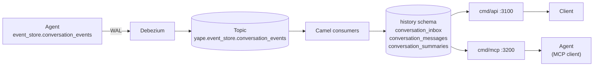

# ms-ml-conv-history-bs

Reads the conversation history of the Yape assistant. It serves the chat between the user and the assistant over a small
HTTP API shaped after the Smooch message, and the history plus statistics about it to an agent as MCP tools.

It only reads. The history tables are written by the Camel consumers (`ms-ml-conv-history-consumer` writes the schema
`history`; the older `ms-ml-camel-conv-history-bs` writes `camel_history`), which read the topic Debezium publishes the agent's
`event_store.conversation_events` to.

PoC for AIP-472. The API and the MCP server have no authentication, so this service must not be deployed.



| Binary | Role | Port |
|--------|------|------|
| `cmd/api` | Reads the history | `3100` |
| `cmd/mcp` | Serves the history and statistics about it to an agent as MCP tools | `3200` |

## Run

Both binaries read `config.yaml` from the working directory, so start them from the repo root. They need Postgres with the
history tables filled (the local cluster in `../cluster` and one of the Camel consumers running).

```bash
go run ./cmd/api          # serve on :3100
go run ./cmd/mcp          # serve MCP on :3200
```

The same, detached, with logs and a start check, as in the agent repo (`scripts/`):

```bash
./scripts/run_api.sh                 # builds bin/api if stale, starts it in the background, waits for /health
./scripts/stop_api.sh
./scripts/run_mcp.sh                 # the same for the MCP server; waits for /health
./scripts/stop_mcp.sh
```

Both run scripts take `--rebuild` (force a build), `--foreground` and `--no-kill` (refuse to replace a
running instance); `run_api.sh` also takes `--port`. They work from any directory, stop a previous
instance first, and exit at once, with the log path, when the binary dies (a wrong config, an unreachable
database). Logs go to `scripts/logs/` and are gitignored. `check-conventions.sh` in the same folder is tracked.

`local/README.md` has the local steps.

## API

```bash
curl -s "localhost:3100/v1/conversations?idYapeAccount=<account>"
curl -s "localhost:3100/v1/conversations/<conversationId>/messages"
curl -sg "localhost:3100/v1/conversations/<conversationId>/messages?page[before]=<_id>&page[size]=20"
curl -sg "localhost:3100/v1/conversations?idYapeAccount=<account>&page[before]=<cursor>"   # the cursor of a conversation, or the one in the Link header
curl -s  localhost:3100/health
```

| Route | Answer |
|-------|--------|
| `GET /v1/conversations/{conversationId}/messages` | up to 100 messages, oldest first; `page[before]` or `page[after]` (one at most) take a message `_id`, `page[size]` asks for fewer; more pages are announced in the `Link` header |
| `GET /v1/conversations?idYapeAccount=&page[before]=&page[after]=&page[size]=` | a page of the account's conversations with chat messages, most recent first; each carries an opaque `cursor`; more pages are announced in the `Link` header |
| `GET /health` | `200` when the database answers, `503` otherwise |

The contract is `docs/ms-ml-conv-history-bs-openapi.yml` (Swagger 2.0), generated from the swag annotations
in `cmd/api/main.go` and the handlers, as in `cpgs-clg-core`: `make openapi` regenerates it and
`make openapi/check` fails when it is stale. A test fails when a served route is not documented, and
another when a reply carries a field the spec does not describe.

Errors are RFC 9457 problem details served as `application/problem+json` (`type`, `title`,
`status`, `detail`): `400` for a malformed id or account, both cursors, a bad `page[size]` or a
cursor the API did not issue; `404` for a conversation with no chat messages; `503` for a request
that ran past its 10 second deadline. A client decides from `type`. `docs/design.md` has the
problem types and the paging rules.

## MCP

`cmd/mcp` gives an agent read-only tools over the same tables. It speaks MCP over streamable HTTP, with no
session kept between calls, at `http://localhost:3200/mcp` (`GET /health` for the database). Connect GitHub Copilot to it with:

```bash
copilot mcp add --transport http conv-history-local http://localhost:3200/mcp
```

| Tool | Answers | Reads |
|------|---------|-------|
| `list_accounts` | which accounts have history, how many conversations and messages, when last active | `conversation_summaries` |
| `get_recent_conversations` | an account's latest conversations (no text) | the `History` service, as the API |
| `get_transcript` | the chat of a conversation, newest page first, paged back with `before` | the `History` service, as the API |
| `get_activity_funnel` | how an account's attempts of a flow ended: approved, rejected, failed, abandoned, expired, open, none | `conversation_flow_segments` |
| `get_latency_stats` | seconds from the request to the card and from the card to the decision, with and without an OTP | `conversation_flow_segments`, `conversation_inbox` |
| `get_tool_health` | calls and failures of each tool of the agent | `conversation_inbox` |

The account is an argument of each tool, because the PoC has no authentication: an agent that can call
a tool can read any account. `list_accounts` is how it finds the ids. `docs/design.md` has the rules each tool follows.

## Configuration

`config.yaml` expands `${VAR:-default}`; `.env` (committed: it holds only the local development values) can set the variables; other `.env.*` files are git-ignored.

| Variable | Default |
|----------|---------|
| `SERVER_PORT` | `3100` |
| `MCP_HOST`, `MCP_PORT` | `127.0.0.1`, `3200` (read by `cmd/mcp` only; it stays on the loopback interface because it has no authentication) |
| `POSTGRES_DSN` | empty; when set it wins over the fields below |
| `POSTGRES_HOST`, `POSTGRES_PORT`, `POSTGRES_USER`, `POSTGRES_PASSWORD`, `POSTGRES_DB` | `localhost`, `5432`, `postgres`, empty, `postgres` |
| `POSTGRES_SSL_MODE` | `disable` |
| `POSTGRES_SEARCH_PATH` | `history`, the tables the Camel consumers fill; `camel_history` is the old consumer's; empty keeps the database user's own. With `POSTGRES_DSN`, put `search_path` in the DSN |
| `POSTGRES_MAX_CONNS`, `POSTGRES_MIN_CONNS` | `10`, `2` |
| `POSTGRES_CONN_MAX_LIFETIME`, `POSTGRES_CONN_MAX_IDLE_TIME`, `POSTGRES_CONNECT_TIMEOUT` | `3600`, `300`, `10` (seconds) |
| `LOG_LEVEL` | `info` |
| `ENVIRONMENT` | `development`; `production` skips reading `.env` |

## Database

The service reads three tables, in the schema `POSTGRES_SEARCH_PATH` names (`history` by default): `conversation_messages` (the
chat), `conversation_summaries` (which the conversation list reads) and `conversation_inbox` (which the statistics read, through
the view `conversation_flow_segments`). The Camel consumers fill them, and the migrations that create them are in
`../ms-ml-conv-history-migrations` (`migrations/history/conversation`; this service owns no migration).

## Tests

```bash
make test         # clean cache, every package suite
make test-race
make cover        # fails under 96% per package
make build        # bin/api and bin/mcp
make it           # integration tests; each starts its own Postgres in Docker and touches nothing else
make check        # vet, conventions (below) and the OpenAPI spec
make openapi      # regenerate the OpenAPI spec (needs swag)
```

### Concurrency

Race conditions are kept out by tests that run under `make test-race`, written in the style of
`cpgs-clg-core`'s executor: how a batch of work runs is a function value
(`internal/testsupport/concurrent`). A scenario runs once one task at a time, which gives the reference
outcome, and once with every task released at the same moment, and the two outcomes must be equal. The
helpers are small pure functions (`Collect`, `Count`, `Map`, `Orders`, `Outcomes`): each task returns its
result into its own slot, so a test needs no mutex and no sleep.

Guards exist for the HTTP server, the history service and config loading. `scripts/check-conventions.sh` keeps new
ones out: production code starts no goroutine outside `cmd/`, and a test does not wait with `time.Sleep`.

### Integration tests

`make it` needs Docker and nothing else, and no other repository: it does not look for the local cluster, does not read its
ports and writes nothing to it. Each test starts one Postgres 18 in a container (testcontainers) with a host port picked free
at that moment and a memory cap, creates the schema `history` from `it/history/testdata/schema.sql`, seeds rows with plain SQL,
and checks the read API (`TestRead`, `TestAPI`), the statistics (`TestInsights`, `TestFlowSegments`), the shape the queries rely
on (`TestSchema`) and paging at volume. `schema.sql` is a verbatim copy of the four `history/conversation` up migrations of
`ms-ml-conv-history-migrations`, which stays the source of truth; refresh it with `cat` of that folder when they change.

A run killed early leaves its container behind (Ryuk is off: Colima does not give it the Docker socket). Containers are
labelled: `docker rm -f $(docker ps -aq --filter label=conv-history-it)`.

Mocks come from `//go:generate mockery` directives next to each port; regenerate one with
`go generate ./internal/core/port/service/<file>.go`.

## Layout

Hexagonal, as `cpgs-clg-core`: `internal/core` never imports `internal/infrastructure`.

```text
cmd/{api,mcp}/                  wiring only
internal/config/                config.yaml loader
internal/core/domain/           types and sentinel errors
internal/core/history/          paging rules
internal/core/insights/         statistics: funnel, latency, tool health, accounts
internal/core/port/{repository,service}/   interfaces + mocks/
internal/infrastructure/
  api/ api/handler/             Echo server and handlers
  mcp/                          MCP server: tools, output types, error wording
  logging/                      lib-go-log adapter
  postgresql/ postgresql/repository/   pgx pool, messages and insights queries, SQL/
internal/testsupport/           test helpers: throwaway Postgres, concurrent/ (executors)
it/history/                     integration tests
local/                          running the API locally
scripts/                        run_*/stop_* for both binaries, check-conventions.sh (rules the linter cannot express)
docs/                           design.md and the OpenAPI spec
```
