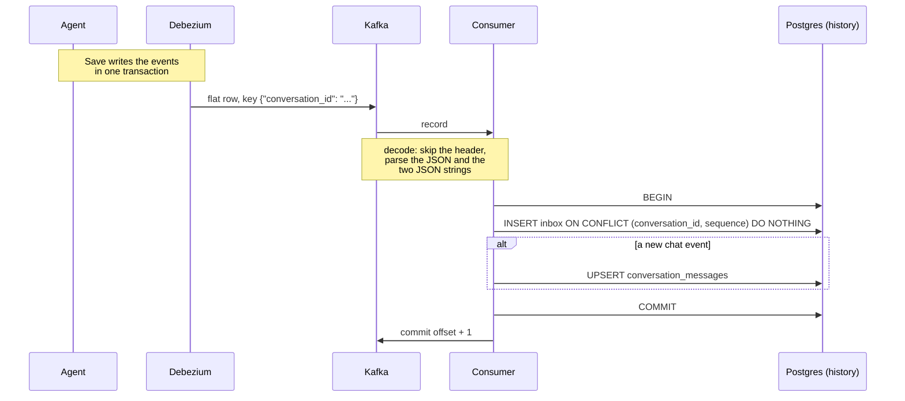
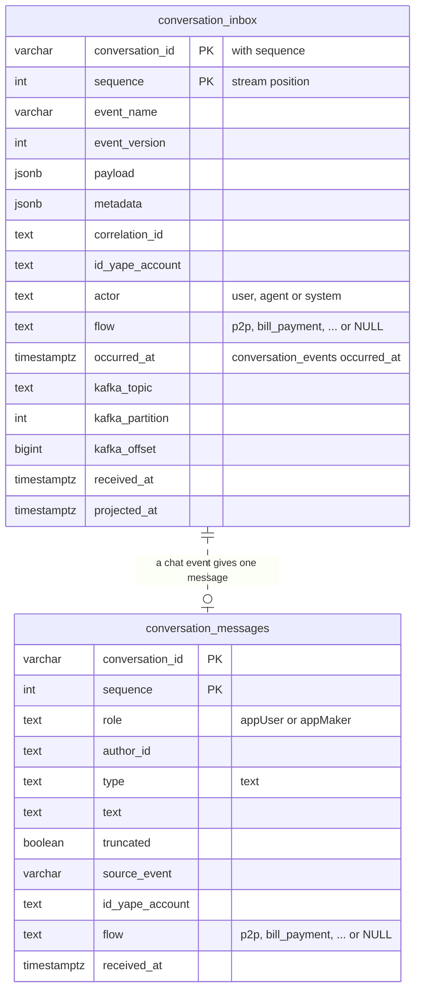
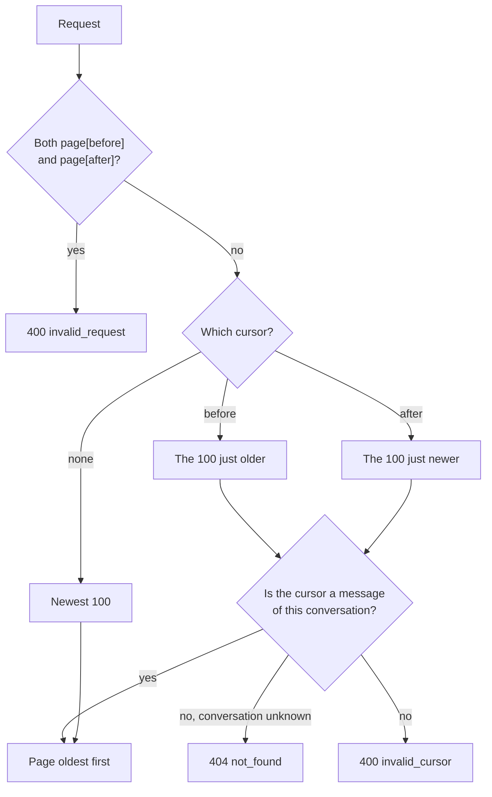

# Design

How the events of the agent's `conversation_events` table become a chat history. Scope: the conversation log of every flow;
the P2P flow is the first to record facts of its own.

## Data flow



The offset moves only after the commit. Delivery is at least once: a redelivered event hits the
inbox primary key and writes nothing.

## What Debezium publishes

One connector, `conversation-events`, owned by the agent repo (`local/debezium/`). It captures
`public.conversation_events` only, through its own publication and replication slot, and
publishes the flat row (no `before`/`after` envelope) to `yape.public.conversation_events`. The table is
append-only, keyed by `(conversation_id, sequence)` and never pruned, so a re-snapshot can always republish the
whole history. Every column is published, so
adding a column to the table adds a field to the record (the decoder ignores fields it does not know), and a
column that must not leave the database is excluded in the connector.

| Part | Format |
|------|--------|
| Key | 5-byte Schema Registry header + `{"conversation_id": "<id>"}` (`message.key.columns`), so a conversation stays on one partition, in order |
| Value | 5-byte header + the row as JSON: `conversation_id`, `sequence`, `event_name`, `event_version`, `payload`, `metadata`, `correlation_id`, `id_yape_account`, `actor`, `flow`, `occurred_at` |
| `payload`, `metadata` | JSON **strings** (JSONB arrives as text) |
| `occurred_at` | RFC 3339, microseconds, `Z` |
| Delete in the event store | not published (the delete and its tombstone are dropped); the consumer still skips a tombstone if one arrives |

`testdata/events-record.{key,value}.bin` is a real record. The decoder (`internal/infrastructure/kafka/decoder.go`)
skips the header when the first byte is `0`, accepts plain JSON, parses the two strings,
ignores unknown fields, and returns `nil` for a tombstone. Anything else it cannot read is a
`*DecodeError` with topic, partition, offset, reason and field name, never the content.

## Consumer rules

| Case | What happens |
|------|--------------|
| New event | stored in the inbox; a chat event also gets its message; offset committed |
| Event already in the inbox | nothing written; offset committed |
| Tombstone | offset committed |
| Record that cannot be decoded | logged without content, counted, offset committed |
| Event that should project but lacks its text | stored in the inbox without a message, counted as invalid; offset committed |
| Value the columns cannot hold (sequence or version out of range, an id or name over 128 characters) | refused by the decoder like any malformed record: logged without content, counted, offset committed |
| Store refuses for good: a constraint violation (SQLSTATE class 23) or data it cannot hold (class 22, such as a NUL character in the payload) | logged with the class, constraint and code only (Postgres puts the failing row in the error detail), counted as rejected, offset committed |
| A different event at a stream position the inbox already holds (name, version, payload or metadata differ) | refused as rejected and logged at error level, so the event is not lost without a trace |
| Store error that a retry can fix (database down) | retried in place, wait 1 s doubling to 30 s; the offset does not move until it works or the process stops |
| Offset commit fails | the error is returned to the Kafka library, which logs it; a later commit covers it; if none comes the broker redelivers and the inbox ignores it |

A record that can never be stored never blocks a partition: retrying it would not help, so it is skipped and counted. A database outage blocks it on purpose, and nothing is
lost.

The retry loop does not poll, so an outage longer than `max.poll.interval.ms` (`KAFKA_MAX_POLL_INTERVAL_MS`, 5 minutes) makes the broker drop the member from the group. After the
database returns, the event in hand is stored, its offset commit fails, the broker hands the record out again and the inbox counts it as a duplicate. The outage test shows this with a 10 second
poll interval: ten events stored, one duplicate, every offset committed. `KAFKA_SESSION_TIMEOUT_MS` (45 seconds) must not exceed the poll interval. The library's loop stops on SIGINT and SIGTERM (it listens for them itself) or on a fatal
broker error, and returns no error in either case. The process's own signal context tells them
apart: when the loop ends after the signal, the binary logs its totals and exits 0; when it ends
with no signal (a fatal broker error), it waits one second for the signal to arrive, then logs its
totals and exits 1, so a supervisor restarts it. After the signal, no further record is handled or
committed, which keeps a record that never reaches the store from covering the offset of an event
left unstored.

The Kafka client is Yape's `lib-go-kafkalizer`. Auto commit is off and its automatic error
handling is off, because that path publishes to a dead-letter engine this service does not have.

## Schema

The SQL lives in `ml-genai-agents-bs-testing/migrations/history/conversation/` and comments every column.



The inbox keeps every event that arrives, chat or not, with the Kafka coordinates it came from.
It is the source a rebuild replays. `projected_at` is set in the same transaction as the
projection, so a stamped row is a processed row. An event that should have projected but lacks its
text is stamped too (it is stored without a message and counted as invalid), so `projected_at` does not
find those; the `invalid` counter and the log do.

**Conversation ids are never reused.** The inbox key is `(conversation_id, sequence)`. If a deleted
conversation's id were used again, its new events would meet the inbox's copies: different content is
rejected and identical content is ignored. The BFF issues a new id per conversation, and the event
store is cleaned of whole, closed conversations only.

## Flows

The tables are the conversation log, and every flow writes to it: P2P, bill payment, lending and the
generalist all land in `conversation_events`, because one chat can cross several of them. So the names stay
`conversation_*` and the migrations live in the `conversation` folders. A flow with tables of its own gets
a folder and table names that carry the flow (`bill_payment_…`).

What tells the flows apart is the `flow` column, a plain column of the event, next to `correlation_id`, `id_yape_account` and `actor`. It is the
flow that was active when the fact arrived:

| Fact | Flow |
|------|------|
| An agent's message or tool summary | the flow of that agent (`p2p_agent`, `p2p_workflow` and `p2p_turn_plan` are `p2p`; `bill_payment_agent` and its private agents are `bill_payment`) |
| A payment fact (contact, card, OTP, resolution, failed notice) | the flow of the recorder that wrote it (`p2p`) |
| A message the user writes, and a notice a service sends in their place (the BFF's, after a card) | the flow of the last agent fact stored in the conversation, which is the agent ADK sends the turn to: the flow they were in when they wrote it. The store reads it from the stream when it saves the fact, so it holds on any session; the notice arrives on the account's session, not the chat's |
| The dispatcher's, generalist's and other specialists' messages; guardrail and failure facts | none |

So the user message that opens a flow has no flow, and the one that leaves a flow carries the flow it was in. The
consumer takes the flow as it comes: a name matching `^[a-z][a-z0-9_]{0,63}$` or nothing; anything else is
skipped as malformed. The repeat check compares it too, so the same position with another flow is rejected.
The projection copies it to the message, and the API shows it in `metadata.flow` when there is one.

### Reading a conversation by flow

`conversation_flow_segments` (history migration `000002`) cuts a conversation into runs, one row per run, from
the inbox. It reads the facts again by who handled them, which settles the two messages the stamping rule
leaves at the edge of a flow:

- A user message belongs to the flow of the next fact that is not a user message, the one that handled it. The
  message that opens a flow joins it; the one that leaves it joins the next run. With no next fact it keeps the
  flow it was written in.
- The conversation's own facts (start, close, a blocked message, the guardrail reply, a failed turn) take the flow
  of the fact before them, so they never split a run.
- A run is consecutive facts in one flow, or in none. It ends at a `ConfirmationResolved`: the first user message
  after one opens the next run, which tells two transfers in a row apart.
- `outcome` comes from the payment facts: the decision of the last `ConfirmationResolved` (`approved`, `rejected`
  or `failed`); `abandoned` when a card was offered, never resolved, and another run followed; `expired` when it
  was the last run and ten minutes have passed (the approval's lifetime); `open` before that; `none` when the run
  offered no card.

```sql
SELECT run, coalesce(flow, '(none)') AS flow, from_sequence, to_sequence, events, outcome
FROM conversation_flow_segments
WHERE conversation_id = $1
ORDER BY run;
```

Every step of the view is a window over `(conversation_id, …)`, and the step read twice is `NOT MATERIALIZED`, so a
filter on `conversation_id` reaches the inbox's primary key. Measured on 720,000 events: one conversation 0.4 ms,
the 600 conversations of an account 62 ms with `conversation_id = ANY (ARRAY(SELECT …))`, the whole table 3.2 s.
`IN (SELECT …)` computes the whole table before it filters, so pass an array for several conversations.

`it/history/flow_segments_test.go` runs the view against real Postgres on seven conversations, and checks from the
query plan that a read of one conversation scans only its own rows of the inbox.

## Projection

| Event | Role | Text | Author |
|-------|------|------|--------|
| `UserMessageSent` | `appUser` | `payload.text` | the account (`id_yape_account`) |
| `AgentMessageSent` | `appMaker` | `payload.text` | `ms-ml-genai-agent-bs` |
| `GuardrailResponseSent` | `appMaker` | `payload.response_text` | `ms-ml-genai-agent-bs` |

Every other event stays in the inbox only: tool summaries, notifications, confirmations,
`UserMessageBlocked` (the blocked text never reaches the history) and unknown names. A chat event
without its text field is invalid, not skipped. An empty string is a valid text.

**Order does not depend on arrival.** The key of a message is `(conversation_id, sequence)`, the
position the agent gave the event, so records read from three partitions in any order give the
same rows. **Rebuild** deletes the messages and replays the inbox in `(conversation_id, sequence)`
order, in keyset batches of 500, in one transaction: readers see the old rows until the commit,
and a cancelled run changes nothing. The inbox is never modified.

## API

Shaped after the Smooch (Sunshine Conversations) v2 list-messages call.

```json
{
  "conversation": { "_id": "conv_v1_8ab59029-bc3c-4e77-b49f-9fb053d90c52" },
  "messages": [
    { "_id": "2", "type": "text", "role": "appUser", "authorId": "<idYapeAccount>", "text": "quiero yapear",
      "received": 1792505243.792, "source": { "type": "api" },
      "metadata": { "sequence": 2, "sourceEvent": "UserMessageSent", "truncated": false, "flow": "p2p" } }
  ],
  "meta": { "hasMore": true, "beforeCursor": "2", "afterCursor": "11" },
  "links": { "prev": "/v1/conversations/conv_v1_.../messages?page[before]=2" }
}
```

| Smooch field | Source |
|--------------|--------|
| `_id` | the event's `sequence`, as a string; unique within the conversation |
| `role`, `authorId` | the projection table above |
| `received` | the event time, Unix seconds with milliseconds |
| `metadata` | `sequence`, `sourceEvent`, `truncated`, and `flow` when the message took place in a flow |

Left out: `name`, `avatarUrl`, `actions`, `items`, `mediaUrl`, `quotedMessage`, `subroles`. There is no
`POST`: messages enter only through Kafka.

### Paging

The cursor is a message `_id`, as in Smooch. The server finds it with
`WHERE conversation_id = $1 AND sequence = $2`, which proves the cursor is a message of the conversation. The sequence is the cursor, and `sequence < $2` or `> $2` picks the page. A page is 100 messages.



| Request | `hasMore` means | Link |
|---------|-----------------|------|
| no cursor, or `page[before]` | older messages exist | `links.prev` = `page[before]=<first _id>` |
| `page[after]` | newer messages exist | `links.next` = `page[after]=<last _id>` |

A link is present only when there is more in the direction of travel. A page past the last message
is `messages: []` with no cursors. `beforeCursor` is the first message of the page, `afterCursor` the
last. The store reads 101 rows and trims one, so `hasMore` costs no second query.

A conversation is known when it has chat messages; a conversation of tool events alone answers `404`.
The conversation list returns the latest 100 with `meta.hasMore` and has no paging. It reads the
account's messages through `conversation_messages_account_idx (id_yape_account, received_at DESC)`, so its
cost grows with the account's history: an account with 80 messages touches 13 buffers and one with 20,000
messages in 500 conversations touches 131 and answers in under 4 ms (measured on 400,000 messages). A
covering index `(id_yape_account, conversation_id, received_at DESC)` gave an index-only scan, but not
fewer buffers on the heavy account, so the index stays as it is. The step after that, when a single
account reaches millions of messages, is a conversations table.

| Status | Code | When |
|--------|------|------|
| 400 | `invalid_request` | malformed conversation id or account, both cursors, no account |
| 400 | `invalid_cursor` | not a plain decimal `_id`, or not a message of that conversation |
| 404 | `not_found` | no chat messages for that conversation, or an unknown route |
| 500 | `internal_error` | store error; the cause goes to the log only |

Error bodies are `{"error": {"code": ..., "description": ...}}` and never repeat the request.

## OpenAPI

The contract is `docs/ms-ml-conv-history-bs-openapi.yml` (Swagger 2.0), generated by `swag init` from the
annotations: the general info on `main` in `cmd/api/main.go`, and `@Summary`, `@Description`, `@Tags`,
`@Param`, `@Success`, `@Failure` and `@Router` on each handler. Response types carry `example` and `enums`
tags and field comments, which become the descriptions. `make openapi` regenerates it; `make openapi/check`
regenerates into a temporary directory and fails on any difference. Two tests keep the spec honest: every
route the server serves is documented and every documented route is served, and the real replies (pages,
lists, each error, `/health`) contain no field the spec does not describe and no value outside its enums.

## Concurrency

Several writers meet in one database: consumers of different groups, a rebuild, the API reading. The
rules that keep it correct are in the schema and the queries (the inbox primary key, `(conversation_id,
sequence)`, upserts by position), and tests keep them correct as the code changes.

| Guard | What it proves |
|-------|----------------|
| `TestConcurrentWriters` (real Postgres) | the same event from 30 writers is stored once; five consumers feeding the whole stream in five orders, and rebuilds running beside two consumers, leave the rows one writer leaves |
| `TestServerAnswersTheSameWhenRequestsArriveAtOnce` | 64 requests over 8 routes at once answer as they do one at a time: the server holds no shared state |
| service, projection, decoder, config guards | the same calls at once give the same results |
| `TestConsumerCountersCanBeReadWhileItConsumes` | the consumer's counters can be read from another goroutine while it counts |

Each runs a scenario with every executor of `internal/testsupport/concurrent` (one task at a time, then all
at once) and compares the outcomes. They fail under `-race` when shared state is introduced.

**Two writers storing the same event.** The stream key, `(conversation_id, sequence)`, is the primary key and
the `ON CONFLICT` target, so Postgres settles the race without an error: one writer inserts, the other sees
`RowsAffected = 0`. `Apply` then compares the stored event with its own (name, version, payload and metadata,
the JSON by value). Equal is a repeat and writes nothing; different is `ErrRejected`.

Production code starts no goroutine outside `internal/core/async`, whose executor a test can swap, and a
test does not wait with `time.Sleep`; `scripts/check-conventions.sh` enforces both. Nothing in the service
needs background work yet, so the seam has no caller; `internal/core/async/usage_test.go` is the worked
reference for the first one:

| Pattern | Use it for | How the test controls it |
|---------|------------|--------------------------|
| Fire and forget | one-shot work that must not slow the caller (an audit entry, a metric) | the synchronous executor finishes before the call returns; the real one is awaited on a channel |
| Deferred executor | proving an ordering | the test queues the tasks and runs them in the order it picks (five fixed orders) |
| All at once | proving there is no shared state | the queued tasks go to the concurrent helpers, which release them together; the outcome must equal the one-at-a-time outcome, under `-race` |
| Worker bound to a context | a loop (housekeeping, a lag reporter) | cancel the context and wait on the channel the worker closes; the real executor only, a loop would never return under the synchronous one |
| One worker per partition | parallel consumption | a finite task per partition, in order within it, each writing only its own slot; the synchronous executor is the reference outcome

## Configuration values

`config.yaml` is parsed first and `${VAR:-default}` is expanded in the parsed values. A value is data and
never YAML: a password such as `pa #ss`, `*x`, `'q'`, `null` or one with a newline arrives exactly as set. A
number that does not parse (`SERVER_PORT=abc`) fails the load with the field type. Both binaries read
`config.yaml` from the working directory, so start them from the repo root.

## Request parameters

| Case | Answer |
|------|--------|
| `page[before]=` or `page[after]=` sent empty | `400 invalid_cursor` |
| An empty cursor beside a real one | `400 invalid_request` (two cursors) |
| `page[before]`, `page[after]` or `idYapeAccount` sent twice | `400 invalid_request` |
| A cursor with a sign, spaces, leading zeros, an exponent or a NUL | `400 invalid_cursor` |
| `page[size]` or any unknown parameter | ignored: a page is always 100 |

## Privacy

No message text, cursor, conversation id or account id reaches a log. The consumer names an event
by its Kafka coordinates (`topic/partition/offset`) and logs counts; the API logs the route pattern
and not the URL. Decode errors carry the coordinates, a reason and a field name. Database errors are
printed from their SQLSTATE, and from the server's message only for classes that cannot quote a value
(connection, serialization, resources, operator shutdown); the detail, hint and context never are. A
test with a secret in every part of the error pins this. The API has no authentication, so it must not
be deployed.

Only ids the API can serve are stored: `conversation_id` and `id_yape_account` must match
`^[A-Za-z0-9._:-]{1,128}$`, the same rule the API applies to its parameters. A record outside it is
skipped and counted as malformed, with the field name in the log.

## Operations

| Task | How |
|------|-----|
| Recreate the messages | `go run ./cmd/consumer rebuild` |
| Check the history against the event store | `local/scripts/verify.sh` |
| Events deleted from the tail of a live conversation and written again | the new events reuse old positions and the inbox refuses them (rejected, logged at error level). Delete whole, closed conversations only. To start over, drop the history tables (`make migrations/down CONFIRM=yes`, then `up`) and reset the consumer group offsets (`local/README.md`) |
| Events deleted from the event store | not published; the history keeps its copy of the conversation. Clear it from the history too if the deletion is for erasure |
| Replication slot lag | a stopped connector with a live slot makes Postgres keep WAL; drop the slot when the connector is retired for good (`ms-ml-genai-agents-bs/local/debezium/README.md`) |
| Test records on the shared topic | the Debezium pipeline test leaves rows with `conversation_id` starting `pipeline-dbz-` and account `acc-pipeline` |
