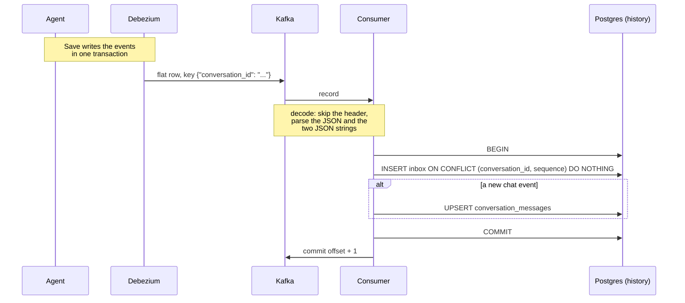
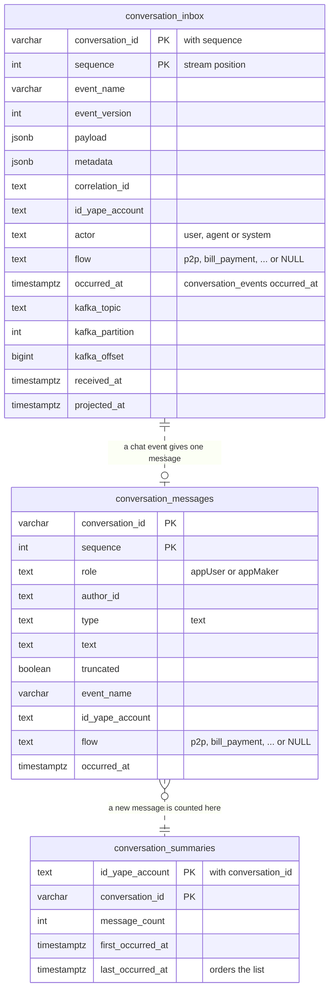
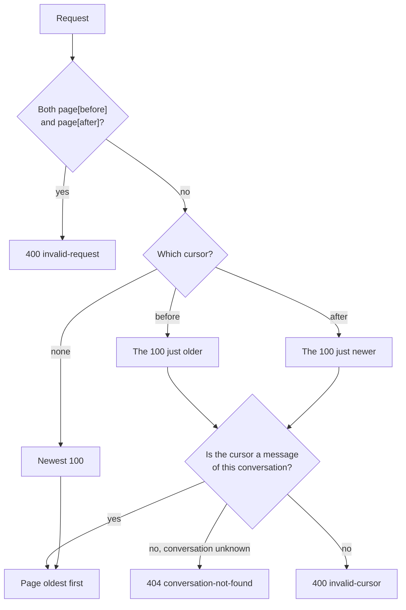

# Design

How the events of the agent's `conversation_events` table become a chat history. Scope: the conversation log of every flow;
the P2P flow is the first to record facts of its own.

## Data flow



The offset moves only after the commit. Delivery is at least once: a redelivered event hits the
inbox primary key and writes nothing.

## What Debezium publishes

One connector, `conversation-events`, owned by the agent repo (`local/debezium/`). It captures
`public.conversation_events` only, through its own publication and replication slot, and
publishes the flat row (no `before`/`after` envelope) to `yape.public.conversation_events`. The table is
append-only, keyed by `(conversation_id, sequence)` and never pruned, so a re-snapshot can always republish the
whole history. Every column is published, so
adding a column to the table adds a field to the record (the decoder ignores fields it does not know), and a
column that must not leave the database is excluded in the connector.

| Part | Format |
|------|--------|
| Key | 5-byte Schema Registry header + `{"conversation_id": "<id>"}` (`message.key.columns`), so a conversation stays on one partition, in order |
| Value | 5-byte header + the row as JSON: `conversation_id`, `sequence`, `event_name`, `event_version`, `payload`, `metadata`, `correlation_id`, `id_yape_account`, `actor`, `flow`, `occurred_at` |
| `payload`, `metadata` | JSON **strings** (JSONB arrives as text) |
| `occurred_at` | RFC 3339, microseconds, `Z` |
| Delete in the event store | not published (the delete and its tombstone are dropped); the consumer still skips a tombstone if one arrives |

`testdata/events-record.{key,value}.bin` is a real record. The decoder (`internal/infrastructure/kafka/decoder.go`)
skips the header when the first byte is `0`, accepts plain JSON, parses the two strings,
ignores unknown fields, and returns `nil` for a tombstone. Anything else it cannot read is a
`*DecodeError` with topic, partition, offset, reason and field name, never the content.

## Consumer rules

| Case | What happens |
|------|--------------|
| New event | stored in the inbox; a chat event also gets its message; offset committed |
| Event already in the inbox | nothing written; offset committed |
| Tombstone | offset committed |
| Record that cannot be decoded | logged without content, counted, offset committed |
| Event that should project but lacks its text | stored in the inbox without a message, counted as invalid; offset committed |
| Value the columns cannot hold (sequence or version out of range, an id or name over 128 characters) | refused by the decoder like any malformed record: logged without content, counted, offset committed |
| Store refuses for good: a constraint violation (SQLSTATE class 23) or data it cannot hold (class 22, such as a NUL character in the payload) | logged with the class, constraint and code only (Postgres puts the failing row in the error detail), counted as rejected, offset committed |
| A different event at a stream position the inbox already holds (name, version, payload or metadata differ) | refused as rejected and logged at error level, so the event is not lost without a trace |
| Store error that a retry can fix (database down) | retried in place, wait 1 s doubling to 30 s; the offset does not move until it works or the process stops |
| Offset commit fails | the error is returned to the Kafka library, which logs it; a later commit covers it; if none comes the broker redelivers and the inbox ignores it |

A record that can never be stored never blocks a partition: retrying it would not help, so it is skipped and counted. A database outage blocks it on purpose, and nothing is
lost.

The retry loop does not poll, so an outage longer than `max.poll.interval.ms` (`KAFKA_MAX_POLL_INTERVAL_MS`, 5 minutes) makes the broker drop the member from the group. After the
database returns, the event in hand is stored, its offset commit fails, the broker hands the record out again and the inbox counts it as a duplicate. The outage test shows this with a 10 second
poll interval: ten events stored, one duplicate, every offset committed. `KAFKA_SESSION_TIMEOUT_MS` (45 seconds) must not exceed the poll interval. The library's loop stops on SIGINT and SIGTERM (it listens for them itself) or on a fatal
broker error, and returns no error in either case. The process's own signal context tells them
apart: when the loop ends after the signal, the binary logs its totals and exits 0; when it ends
with no signal (a fatal broker error), it waits one second for the signal to arrive, then logs its
totals and exits 1, so a supervisor restarts it. After the signal, no further record is handled or
committed, which keeps a record that never reaches the store from covering the offset of an event
left unstored.

The Kafka client is Yape's `lib-go-kafkalizer`. Auto commit is off and its automatic error
handling is off, because that path publishes to a dead-letter engine this service does not have.

## Schema

The SQL lives in `ml-genai-agents-bs-testing/migrations/history/conversation/` and comments every column.



The inbox keeps every event that arrives, chat or not, with the Kafka coordinates it came from.
It is the source a rebuild replays. `projected_at` is set in the same transaction as the
projection, so a stamped row is a processed row. An event that should have projected but lacks its
text is stamped too (it is stored without a message and counted as invalid), so `projected_at` does not
find those; the `invalid` counter and the log do.

`conversation_summaries` (history migration `000003`) has one row per conversation of an account: its message count and the times of
its first and last message. The conversation list reads it, so a page costs the rows it returns and not the account's history (see
Paging the conversation list). The consumer keeps it in the same transaction that writes a message, and only for a message that was
not stored yet: it adds one to the count and widens the first and last times. Those updates commute, so events in any order, or two
writers at once, end with the same row, and a redelivery or a replay cannot count a message twice. A message with no account is in no
account's list and is not counted. The primary key is `(id_yape_account, conversation_id)`; the index
`conversation_summaries_list_idx (id_yape_account, last_occurred_at DESC, conversation_id DESC)` is the order of the list. Both of its
columns run the same way on purpose: the cursor is the pair `(last_occurred_at, conversation_id)`, and Postgres turns a comparison of
two such pairs into the boundary of an index scan only when the columns run in the same direction. The migration fills the table
from the messages already stored, and running it again rewrites the same values.

**Conversation ids are never reused.** The inbox key is `(conversation_id, sequence)`. If a deleted
conversation's id were used again, its new events would meet the inbox's copies: different content is
rejected and identical content is ignored. The BFF issues a new id per conversation, and the event
store is cleaned of whole, closed conversations only.

## Flows

The tables are the conversation log, and every flow writes to it: P2P, bill payment, lending and the
generalist all land in `conversation_events`, because one chat can cross several of them. So the names stay
`conversation_*` and the migrations live in the `conversation` folders. A flow with tables of its own gets
a folder and table names that carry the flow (`bill_payment_…`).

What tells the flows apart is the `flow` column, a plain column of the event, next to `correlation_id`, `id_yape_account` and `actor`. It is the
flow that was active when the fact arrived:

| Fact | Flow |
|------|------|
| An agent's message or tool summary | the flow of that agent (`p2p_agent`, `p2p_workflow` and `p2p_turn_plan` are `p2p`; `bill_payment_agent` and its private agents are `bill_payment`) |
| A payment fact (contact, card, OTP, resolution, failed notice) | the flow of the recorder that wrote it (`p2p`) |
| A message the user writes, and a notice a service sends in their place (the BFF's, after a card) | the flow of the last agent fact stored in the conversation, which is the agent ADK sends the turn to: the flow they were in when they wrote it. The store reads it from the stream when it saves the fact, so it holds on any session; the notice arrives on the account's session, not the chat's |
| The dispatcher's, generalist's and other specialists' messages; guardrail and failure facts | none |

So the user message that opens a flow has no flow, and the one that leaves a flow carries the flow it was in. The
consumer takes the flow as it comes: a name matching `^[a-z][a-z0-9_]{0,63}$` or nothing; anything else is
skipped as malformed. The repeat check compares it too, so the same position with another flow is rejected.
The projection copies it to the message, and the API shows it in `metadata.flow` when there is one.

### Reading a conversation by flow

`conversation_flow_segments` (history migration `000002`) cuts a conversation into segments, one row per segment, from
the inbox. It reads the facts again by who handled them, which settles the two messages the stamping rule
leaves at the edge of a flow:

- A user message belongs to the flow of the next fact that is not a user message, the one that handled it. The
  message that opens a flow joins it; the one that leaves it joins the next segment. With no next fact it keeps the
  flow it was written in.
- The conversation's own facts (start, close, a blocked message, the guardrail reply, a failed turn) take the flow
  of the fact before them, so they never split a segment.
- A segment is consecutive facts in one flow, or in none. It ends at a `ConfirmationResolved`: the first user message
  after one opens the next segment, which tells two transfers in a row apart.
- `outcome` comes from the payment facts: the decision of the last `ConfirmationResolved` (`approved`, `rejected`
  or `failed`); `abandoned` when a card was offered, never resolved, and another segment followed; `expired` when it
  was the last segment and ten minutes have passed (the approval's lifetime); `open` before that; `none` when the segment
  offered no card.

```sql
SELECT segment, coalesce(flow, '(none)') AS flow, from_sequence, to_sequence, events, outcome
FROM conversation_flow_segments
WHERE conversation_id = $1
ORDER BY segment;
```

Every step of the view is a window over `(conversation_id, …)`, and the step read twice is `NOT MATERIALIZED`, so a
filter on `conversation_id` reaches the inbox's primary key. Measured on 720,000 events: one conversation 0.4 ms,
the 600 conversations of an account 62 ms with `conversation_id = ANY (ARRAY(SELECT …))`, the whole table 3.2 s.
`IN (SELECT …)` computes the whole table before it filters, so pass an array for several conversations.

`it/history/flow_segments_test.go` runs the view against real Postgres on seven conversations, and checks from the
query plan that a read of one conversation scans only its own rows of the inbox.

## Projection

| Event | Role | Text | Author |
|-------|------|------|--------|
| `UserMessageSent` | `appUser` | `payload.text` | the account (`id_yape_account`) |
| `AgentMessageSent` | `appMaker` | `payload.text` | `ms-ml-genai-agent-bs` |
| `GuardrailResponseSent` | `appMaker` | `payload.response_text` | `ms-ml-genai-agent-bs` |

Every other event stays in the inbox only: tool summaries, notifications, confirmations,
`UserMessageBlocked` (the blocked text never reaches the history) and unknown names. A chat event
without its text field is invalid, not skipped. An empty string is a valid text.

**Order does not depend on arrival.** The key of a message is `(conversation_id, sequence)`, the
position the agent gave the event, so records read from three partitions in any order give the
same rows. **Rebuild** deletes the messages and their conversation summaries and replays the inbox in
`(conversation_id, sequence)` order, in keyset batches of 500, in one transaction: the replay writes the
messages and counts them again, readers see the old rows until the commit, and a cancelled run changes
nothing. The inbox is never modified. A rebuild also repairs summaries that drifted for any reason.

## API

Shaped after the Smooch (Sunshine Conversations) v2 list-messages call. The body holds the data only; the way to
another page is the `Link` header (RFC 8288).

```http
HTTP/1.1 200 OK
Link: </v1/conversations/conv_v1_8ab59029-bc3c-4e77-b49f-9fb053d90c52/messages?page[before]=2>; rel="prev"
```
```json
{
  "conversation": { "_id": "conv_v1_8ab59029-bc3c-4e77-b49f-9fb053d90c52" },
  "messages": [
    { "_id": "2", "type": "text", "role": "appUser", "authorId": "<idYapeAccount>", "text": "quiero yapear",
      "received": 1792505243.792, "source": { "type": "api" },
      "metadata": { "sequence": 2, "eventName": "UserMessageSent", "truncated": false, "flow": "p2p" } }
  ]
}
```

| Smooch field | Source |
|--------------|--------|
| `_id` | the event's `sequence`, as a string; unique within the conversation |
| `role`, `authorId` | the projection table above |
| `received` | the event time, Unix seconds with milliseconds |
| `metadata` | `sequence`, `eventName`, `truncated`, and `flow` when the message took place in a flow |

Left out: `name`, `avatarUrl`, `actions`, `items`, `mediaUrl`, `quotedMessage`, `subroles`. There is no
`POST`: messages enter only through Kafka.

### Paging

The cursor is a message `_id`, as in Smooch. The server finds it with
`WHERE conversation_id = $1 AND sequence = $2`, which proves the cursor is a message of the conversation. The sequence is the cursor, and `sequence < $2` or `> $2` picks the page. A page is 100 messages, or `page[size]` when the client asks for fewer (1 to 100).



| Request | `Link` header | Meaning |
|---------|--------------|---------|
| no cursor, or `page[before]` | `<...?page[before]=<first _id>>; rel="prev"` | older messages exist |
| `page[after]` | `<...?page[after]=<last _id>>; rel="next"` | newer messages exist |

The header is present only when there is more in the direction of travel; the last page has none, so a client
walks until the header stops. When the page size is not 100 the link repeats `&page[size]=<n>`, so following links keeps
the size the client chose. A page past the last message is `messages: []` with no header. The first and the last
`_id` of a page are the `_id` of its first and last message, so the body needs no cursor fields. The store reads
one row more than the page size and trims it, so knowing that there is more costs no second query.

What a page costs follows its size, not its position or the size of the table. `it/history/paging_volume_test.go` loads 400,000
messages, one conversation of 60,000 among them, and reads the query plans:

| Page | Rows read | Pages touched | Execution |
|------|-----------|---------------|-----------|
| size 1, newest | 2 | 4 | 0.03 ms |
| size 10 | 11 | 4 | 0.02 ms |
| size 50 | 51 | 6 | 0.02 ms |
| size 100 | 101 | 8 | 0.02 ms |
| size 1 or 100, `page[before]` near the end, the middle or the start | size + 1 | 4 / 8 to 9 | 0.02 ms |

A page reads one row more than its size, the plan has no sequential scan and no sort, and the pages touched do not change with the
depth of the cursor. Walking the whole 60,000-message conversation takes 600 calls at size 100 (0.47 s, median 0.6 ms a call)
and 1,200 at size 50 (2.1 s). The test asserts the rows and the pages, which do not depend on the machine; the time ceilings are far above a run.

A conversation is known when it has chat messages; a conversation of tool events alone answers `404`.
### Paging the conversation list

`GET /v1/conversations?idYapeAccount=` pages the same way as the messages, so a client that can walk one can walk the other.
The body holds the conversations only, most recent first inside a page; the way to another page is the `Link` header.
Each conversation carries a `cursor`, its position in the list when it was read.

```http
GET /v1/conversations?idYapeAccount=acc-1&page[size]=2
HTTP/1.1 200 OK
Link: </v1/conversations?idYapeAccount=acc-1&page[before]=1792505243500000~conv_v1_b&page[size]=2>; rel="prev"
```
```json
{ "conversations": [
  { "_id": "conv_v1_a", "cursor": "1792505543500000~conv_v1_a", "messageCount": 5, "firstReceived": 1792505243.5, "lastReceived": 1792505543.5 },
  { "_id": "conv_v1_b", "cursor": "1792505243500000~conv_v1_b", "messageCount": 1, "firstReceived": 1792505243.5, "lastReceived": 1792505243.5 } ] }
```

| Request | Returns | `Link` header |
|---------|---------|---------------|
| no cursor | the most recent conversations | `rel="prev"` = `page[before]=<cursor of the oldest conversation of the page>` when older ones exist |
| `page[before]=X` | the conversations just older than position `X` (less recently active) | `rel="prev"`, same rule |
| `page[after]=X` | the conversations just more recent than position `X` | `rel="next"` = `page[after]=<cursor of the most recent conversation of the page>` when more recent ones exist |

`before` and `after` mean what they mean for messages: older and newer in time. `page[size]` is 1 to 100 (default 100) and is repeated in the link when it is not 100.

**The cursor is a position, not a conversation.** A conversation moves to the top when it receives a message, so a cursor made only of its `_id` would point
somewhere else by the time the next page was asked for, and a page could repeat a conversation. The cursor carries the position itself, the time of the
conversation's last message in Unix microseconds and its `_id` as the tie-break, joined by `~` (`1792505543500000~conv_v1_a`). The server reads the position from the
cursor and looks nothing up, so a walk is right whatever happens to the conversations in between. A client treats the cursor as opaque: it takes it from the `Link`
header, or from the `cursor` of a conversation it holds, and never builds one. A conversation `_id` alone is not a cursor.

A cursor is not tied to an account: it is only a position, and it reveals nothing about any account. The cursor of a conversation of another account, or of one that no
longer exists, simply reads this account's conversations from that position. A value that is not in the form the API writes (empty, no `~`, a bad instant, an id with
characters outside `. _ : -`, letters and digits) answers `400 invalid-cursor`. A page past the last conversation is `conversations: []` with no header; an account with
none gets the same. The last page has no `Link` header.

To pick up what is new since the client last looked, it reads `page[after]` with the `cursor` it stored for the most recent conversation it held. That returns what is
more recent than where that conversation stood, including the conversation itself if it was active again, and any new conversation that appeared in between.

A page is cut by the time of a conversation's last message, with the conversation `_id` as the tie-break, the larger first (`ORDER BY last_occurred_at DESC, conversation_id DESC`), so
conversations that end at the same instant keep one order and no page repeats or skips one. `it/history/read_test.go` pins the cases that matter: a walk in both
directions with ties, a cursor conversation that moves between two pages, and a catch-up after the conversation a client holds moved above a new one.

A page reads `conversation_summaries`, one row per conversation, through `conversation_summaries_list_idx`, from its cursor, and stops after the rows it returns.
What it costs follows the page and not the account's history, the size of the table or how deep the cursor is. `it/history/paging_volume_test.go` loads one account with
5,000 conversations (20,000 messages) among 400,000 messages and reads the query plans:

| Page | Rows read | Pages touched | Execution |
|------|-----------|---------------|-----------|
| most recent, `page[before]` or `page[after]`, size 1 | 2 | 4 to 5 | 0.01 to 0.03 ms |
| size 10 | 11 | 13 to 14 | 0.01 to 0.02 ms |
| size 100 | 101 | 103 to 105 | 0.03 to 0.05 ms |

Every page reads exactly one row more than it returns (which tells whether there is more), through the index, with no sequential scan and no sort, and touches the same
pages for the account with five thousand conversations as for one with ten. Walking all 5,000 conversations takes 50 calls at size 100 (21 ms, median 0.3 ms a call).

The tie-break descends with the time so that the cursor, the pair `(last_occurred_at, conversation_id)`, is the boundary of the index scan itself. With the tie-break
running the other way, Postgres treats part of the cursor as a filter, and a page deep into a long list reads and sorts everything older than the cursor.

Every request has a deadline of 10 seconds (`requestTimeout` in `internal/infrastructure/api/app.go`). A request that runs past it has its query cancelled and is answered
`503` (see Errors), so a request cannot hold a connection for long. A page is cheap now, so the deadline is a safety net and not something a normal request comes near.

### Errors

Every error is a problem details object ([RFC 9457](https://www.rfc-editor.org/info/rfc9457/)) served as `application/problem+json`.

```http
HTTP/1.1 400 Bad Request
Content-Type: application/problem+json
```
```json
{
  "type": "tag:yape.com.pe,2026:conversation-history:invalid-cursor",
  "title": "Invalid cursor",
  "status": 400,
  "detail": "page[before] or page[after] is not the _id of a message in this conversation."
}
```

| Member | Meaning |
|--------|---------|
| `type` | The problem type, a URI and its primary identifier. A client decides what to do from `type`. |
| `title` | A short summary of the type. It does not change from one occurrence to the next; for `about:blank` it is the HTTP status phrase. |
| `status` | The HTTP status of the response, repeated. |
| `detail` | An explanation of this occurrence, for people. A client does not parse it. |

There is no `instance` and there are no extension members: an occurrence identifier would have to point at the request, and a reply never repeats the request
(the account, a cursor or a conversation id), so `detail` says what is wrong and never with which value.

The problem types, under `tag:yape.com.pe,2026:conversation-history:`:

| Type | Status | Title | When |
|------|--------|-------|------|
| `invalid-request` | 400 | Invalid request | malformed conversation id or account, both cursors, no account, a bad or repeated `page[size]`, a parameter sent twice, a request Echo cannot read |
| `invalid-cursor` | 400 | Invalid cursor | messages: not a plain decimal `_id`, or not a message of that conversation. Conversations: empty, or not in the form the API writes |
| `conversation-not-found` | 404 | Conversation not found | no chat messages for that conversation |
| `about:blank` | 404 | Not Found | an unknown route |
| `about:blank` | 405 | Method Not Allowed | a method the route does not accept |
| `about:blank` | 500 | Internal Server Error | store error; the cause goes to the log only, `detail` is a fixed sentence |
| `about:blank` | 503 | Service Unavailable | the request ran past its 10 second deadline and its query was cancelled; trying again may work |
| `about:blank` | any other 4xx Echo raises (415, 429 ...) | the status phrase | `detail` is "The request could not be processed."; nothing is wrong on our side |
| `about:blank` | any other 5xx Echo raises | the status phrase | `detail` is a fixed sentence; the cause is logged |

In code the domain has three sentinel errors, `ErrInvalidRequest`, `ErrInvalidCursor` and `ErrNotFound`, and the handler picks the problem type with `errors.Is`. An invalid
request carries its words in a typed error, `domain.InvalidRequest(format, args...)` (an `*InvalidRequestError`), which still matches `ErrInvalidRequest`; the handler reads
`detail` from it with `errors.As`, through any context wrapped around it, and never from the text of the error. An error that matches the sentinel but carries no
words gets the fixed sentence "The request is invalid.", and a cause that is none of the three is a 500 with a fixed sentence.

The types are tag URIs ([RFC 4151](https://www.rfc-editor.org/info/rfc4151/)): absolute and stable, and valid without a website. RFC 9457 allows a type that does not resolve, so
this table is where a type is documented. A client does not dereference them. A type keeps its meaning for good; a new kind of problem gets a new type, and a status
that means nothing more than itself uses `about:blank`.

## MCP

`cmd/mcp` serves the history to an agent as MCP tools (SDK `modelcontextprotocol/go-sdk`, streamable HTTP, no session kept, so any
instance answers any call). It is a third binary beside the API and the consumer, on `mcp.port` (3200), over the same
Postgres. Like the API it has **no authentication**: an agent that reaches it can read any account, so it must not be deployed. It listens on
`127.0.0.1` unless `MCP_HOST` says otherwise, so the PoC is not offered to the network by default (the API listens on every interface).

Why not call the HTTP API from the tools: the API pages raw messages, which is the wrong grain for statistics (a funnel would walk
every page of every conversation), and no route exposes the outcome of a payment, which only `conversation_flow_segments` knows.
So the tools that read chat (`get_recent_conversations`, `get_transcript`) call the same `History` service as the API, and the
statistics have their own read-only queries in `internal/infrastructure/postgresql/repository/SQL/insight_*.sql` and
`list_accounts.sql`, behind `repository.InsightsRepository` and `service.Insights` (`internal/core/insights`).

| Tool | Arguments | Notes |
|------|-----------|-------|
| `list_accounts` | `limit` (default 20, max 100), `offset` | Groups `conversation_summaries`; an account with only tool events is not listed, as in the API |
| `get_recent_conversations` | `id_yape_account`, `limit` (default 10) | Counts and times, no text |
| `get_transcript` | `conversation_id`, `limit` (default 30), `before` | Newest page; `older_cursor` pages back |
| `get_activity_funnel` | `id_yape_account`, `flow` (default `p2p`), `days` (default 30, max 365) | One segment is one attempt. `cards_offered` = attempts minus `none`; `approval_rate` = approved over the settled ones (everything but `open`) |
| `get_latency_stats` | as above | `ask_to_card_seconds` is the agent's time, `card_to_resolution_seconds` the person's. Attempts that never reached a card are left out |
| `get_tool_health` | as above, `flow` ignored | Any outcome but `ok` counts as a failure |

**Rules every tool follows**

- **Scoped to the account.** Each statement finds the account's conversations with `conversation_id = ANY (ARRAY(SELECT conversation_id FROM
  conversation_summaries WHERE id_yape_account = $1))`, the form that reaches the inbox's primary key (see Reading a conversation by flow).
  A test pins the form in every statement, and `it/history/insights_test.go` checks on real Postgres that one account never sees another's rows.
- **Read-only.** A test fails if a statement holds `insert`, `update`, `delete`, `truncate`, `drop`, `alter` or `create`. Every tool is annotated `readOnlyHint`.
- **Closed input.** An argument a tool does not declare is refused, and `id_yape_account` is required where it applies. There is no tool that takes SQL.
- **Untrusted text.** Message text is what users wrote. `get_transcript` says so in its description and the server's instructions repeat it. Text a
  guardrail blocked never reaches the tools: the inbox keeps it in the payload of `UserMessageBlocked`, like every event, but the only chat the tools read is
  `conversation_messages`, which never holds it, and the statements that read the inbox select a tool name and an outcome and no payload text.
- **Errors worded for the model.** A mistake of the model says what to fix (`days must be from 1 to 365`); a store failure says only "the history is
  unavailable; try again" and the cause goes to the log.
- **Logs.** A call logs the tool name, the outcome and the time. No account, conversation id, cursor or text, as in Privacy.
- **Shape.** Times are RFC 3339 in UTC, durations are seconds rounded to a tenth, rates to a thousandth, and a list is `[]` and never `null`.
- **Bounded.** A call has a 10 second deadline, and a list is at most 100 entries.

**Limits to know**

- The statistics are per account. An account id that does not exist answers with zeros, the same as an account with no attempts; `list_accounts` is how to tell.
- Events carry no structured amounts or recipients (see the event design guide of the PoC), so nothing here can total money or rank recipients. An amount exists only
  inside message text. For money, join the payments ledger or add fields to `ConfirmationRequested`.
- `expired` and `open` depend on the time of the read: a card is `open` for ten minutes and `expired` after.
- `conversation_inbox` has no index on the account, so the tool statements reach it through the summaries. `list_accounts` groups the whole summaries
  table, which is fine for a PoC and not for millions of accounts.

## OpenAPI

The contract is `docs/ms-ml-conv-history-bs-openapi.yml` (Swagger 2.0), generated by `swag init` from the
annotations: the general info on `main` in `cmd/api/main.go`, and `@Summary`, `@Description`, `@Tags`,
`@Param`, `@Success`, `@Failure` and `@Router` on each handler. Response types carry `example` and `enums`
tags and field comments, which become the descriptions. `make openapi` regenerates it; `make openapi/check`
regenerates into a temporary directory and fails on any difference. Two tests keep the spec honest: every
route the server serves is documented and every documented route is served, and the real replies (pages,
lists, each error, `/health`) contain no field the spec does not describe and no value outside its enums.

## Concurrency

Several writers meet in one database: consumers of different groups, a rebuild, the API reading. The
rules that keep it correct are in the schema and the queries (the inbox primary key, `(conversation_id,
sequence)`, upserts by position), and tests keep them correct as the code changes.

| Guard | What it proves |
|-------|----------------|
| `TestConcurrentWriters` (real Postgres) | the same event from 30 writers is stored once; five consumers feeding the whole stream in five orders, and rebuilds running beside two consumers, leave the rows one writer leaves, the conversation summaries included |
| `TestSummariesFollowTheMessages` (real Postgres) | eight writers on one conversation lose no count; twenty shuffled arrival orders give the same summary; a redelivery, a replay and an already stored message count once; a rebuild repairs a wrong count, a wrong time, a missing summary and a summary with no messages |
| `TestServerAnswersTheSameWhenRequestsArriveAtOnce` | 64 requests over 8 routes at once answer as they do one at a time: the server holds no shared state |
| service, projection, decoder, config guards | the same calls at once give the same results |
| `TestConsumerCountersCanBeReadWhileItConsumes` | the consumer's counters can be read from another goroutine while it counts |

Each runs a scenario with every executor of `internal/testsupport/concurrent` (one task at a time, then all
at once) and compares the outcomes. They fail under `-race` when shared state is introduced.

**Two writers storing the same event.** The stream key, `(conversation_id, sequence)`, is the primary key and
the `ON CONFLICT` target, so Postgres settles the race without an error: one writer inserts, the other sees
`RowsAffected = 0`. `Apply` then compares the stored event with its own (name, version, payload and metadata,
the JSON by value). Equal is a repeat and writes nothing; different is `ErrRejected`.

Production code starts no goroutine outside `internal/core/async`, whose executor a test can swap, and a
test does not wait with `time.Sleep`; `scripts/check-conventions.sh` enforces both. Nothing in the service
needs background work yet, so the seam has no caller; `internal/core/async/usage_test.go` is the worked
reference for the first one:

| Pattern | Use it for | How the test controls it |
|---------|------------|--------------------------|
| Fire and forget | one-shot work that must not slow the caller (an audit entry, a metric) | the synchronous executor finishes before the call returns; the real one is awaited on a channel |
| Deferred executor | proving an ordering | the test queues the tasks and runs them in the order it picks (five fixed orders) |
| All at once | proving there is no shared state | the queued tasks go to the concurrent helpers, which release them together; the outcome must equal the one-at-a-time outcome, under `-race` |
| Worker bound to a context | a loop (housekeeping, a lag reporter) | cancel the context and wait on the channel the worker closes; the real executor only, a loop would never return under the synchronous one |
| One worker per partition | parallel consumption | a finite task per partition, in order within it, each writing only its own slot; the synchronous executor is the reference outcome

## Configuration values

`config.yaml` is parsed first and `${VAR:-default}` is expanded in the parsed values. A value is data and
never YAML: a password such as `pa #ss`, `*x`, `'q'`, `null` or one with a newline arrives exactly as set. A
number that does not parse (`SERVER_PORT=abc`) fails the load with the field type. Both binaries read
`config.yaml` from the working directory, so start them from the repo root.

## Request parameters

| Case | Answer |
|------|--------|
| `page[before]=` or `page[after]=` sent empty | `400 invalid-cursor` |
| An empty cursor beside a real one | `400 invalid-request` (two cursors) |
| `page[before]`, `page[after]`, `page[size]` or `idYapeAccount` sent twice (either route) | `400 invalid-request` |
| A cursor with a sign, spaces, leading zeros, an exponent or a NUL | `400 invalid-cursor` |
| `page[size]` outside 1 to 100, empty, or not a plain decimal (`+5`, `05`, `ten`) | `400 invalid-request` |
| Any unknown parameter | ignored |

## Privacy

No message text, cursor, conversation id or account id reaches a log. The consumer names an event
by its Kafka coordinates (`topic/partition/offset`) and logs counts; the API logs the route pattern
and not the URL. Decode errors carry the coordinates, a reason and a field name. Database errors are
printed from their SQLSTATE, and from the server's message only for classes that cannot quote a value
(connection, serialization, resources, operator shutdown); the detail, hint and context never are. A
test with a secret in every part of the error pins this. The API has no authentication, so it must not
be deployed.

Only ids the API can serve are stored: `conversation_id` and `id_yape_account` must match
`^[A-Za-z0-9._:-]{1,128}$`, the same rule the API applies to its parameters. A record outside it is
skipped and counted as malformed, with the field name in the log.

## Operations

| Task | How |
|------|-----|
| Recreate the messages and the conversation summaries | `go run ./cmd/consumer rebuild` |
| Check the history against the event store, and the summaries against the messages | `local/scripts/verify.sh` (section 2b reports `summaries-differing-from-messages`; a rebuild repairs them) |
| Deploy the conversation summaries | stop the consumer, apply migration `000003` (it fills the table from the messages stored), then start the new consumer and API. An old consumer running after the migration would store messages without counting them; a rebuild repairs that |
| Events deleted from the tail of a live conversation and written again | the new events reuse old positions and the inbox refuses them (rejected, logged at error level). Delete whole, closed conversations only. To start over, drop the history tables (`make migrations/down CONFIRM=yes`, then `up`) and reset the consumer group offsets (`local/README.md`) |
| Events deleted from the event store | not published; the history keeps its copy of the conversation. Clear it from the history too if the deletion is for erasure |
| Replication slot lag | a stopped connector with a live slot makes Postgres keep WAL; drop the slot when the connector is retired for good (`ms-ml-genai-agents-bs/local/debezium/README.md`) |
| Integration tests | `make it` and `make pipeline` start their own Postgres, Kafka, Schema Registry and Connect in Docker, on host ports picked free and with memory caps, and remove them at the end: they read and write nothing of the local cluster, so they leave no rows in its history. Earlier versions ran the pipeline tests against the local cluster and left the accounts `acc-pipeline` and `acc-slot` in the history of whoever had a consumer running; if you still have them, clean them with the testing plan's cleanup. A run killed before `TestMain` leaves containers labelled `conv-history-it`: `docker rm -f $(docker ps -aq --filter label=conv-history-it)` |
