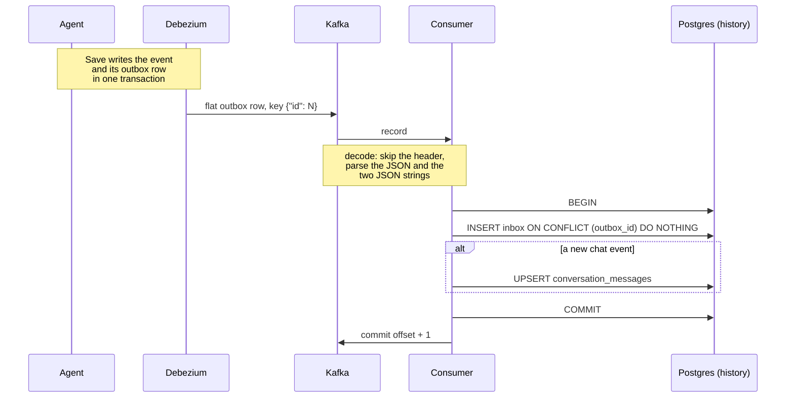
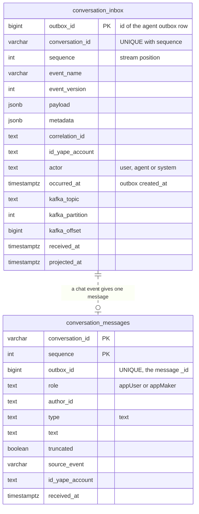
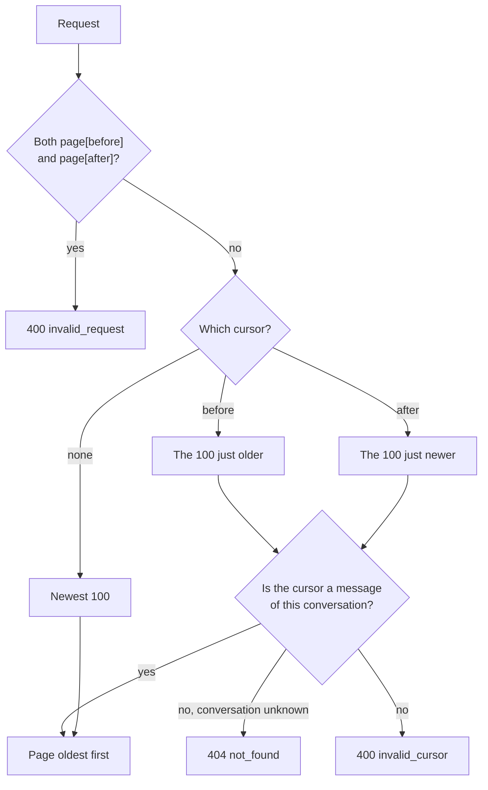

# Design

How the outbox events of the agent become a chat history. Scope: the P2P flow; the same
tables serve other flows.

## Data flow



The offset moves only after the commit. Delivery is at least once: a redelivered event hits the
inbox primary key and writes nothing.

## What Debezium publishes

One connector, `conversation-outbox`, owned by the agent repo (`local/debezium/`). It captures
`public.conversation_outbox` only, through its own publication and replication slot, and
publishes the flat row (no `before`/`after` envelope) to `yape.public.conversation_outbox`.

| Part | Format |
|------|--------|
| Key | 5-byte Schema Registry header + `{"id": <outbox id>}` |
| Value | 5-byte header + the row as JSON: `id`, `conversation_id`, `sequence`, `event_name`, `event_version`, `payload`, `metadata`, `correlation_id`, `id_yape_account`, `actor`, `published`, `created_at` |
| `payload`, `metadata` | JSON **strings** (JSONB arrives as text) |
| `created_at` | RFC 3339, microseconds, `Z` |
| Delete in the outbox | a record with the key and a null value (tombstone) |

`testdata/outbox-record.{key,value}.bin` is a real record. The decoder (`internal/infrastructure/kafka/decoder.go`)
skips the header when the first byte is `0`, accepts plain JSON, parses the two strings,
ignores unknown fields, and returns `nil` for a tombstone. Anything else it cannot read is a
`*DecodeError` with topic, partition, offset, reason and field name, never the content.

## Consumer rules

| Case | What happens |
|------|--------------|
| New event | stored in the inbox; a chat event also gets its message; offset committed |
| Event already in the inbox | nothing written; offset committed |
| Tombstone | offset committed |
| Record that cannot be decoded | logged without content, counted, offset committed |
| Event that should project but lacks its text | stored in the inbox without a message, counted as invalid; offset committed |
| Value the columns cannot hold (id or sequence out of range, an id or name over 128 characters) | refused by the decoder like any malformed record: logged without content, counted, offset committed |
| Store refuses for good: a constraint violation (SQLSTATE class 23) or data it cannot hold (class 22, such as a NUL character in the payload) | logged with the class, constraint and code only (Postgres puts the failing row in the error detail), counted as rejected, offset committed |
| An outbox id that already belongs to another event (the agent's outbox was recreated and its ids restarted) | refused as rejected and logged at error level, so the event is not lost without a trace |
| Store error that a retry can fix (database down) | retried in place, wait 1 s doubling to 30 s; the offset does not move until it works or the process stops |
| Offset commit fails | warned; a later commit covers it; if none comes the broker redelivers and the inbox ignores it |

A record that can never be stored never blocks a partition: retrying it would not help, so it is skipped and counted. A database outage blocks it on purpose, and nothing is
lost. The library's loop stops on SIGINT and SIGTERM (it listens for them itself) or on a fatal
broker error; the binary then logs its totals and exits 0.

The Kafka client is Yape's `lib-go-kafkalizer`. Auto commit is off and its automatic error
handling is off, because that path publishes to a dead-letter engine this service does not have.

## Schema

The SQL lives in `ml-genai-agents-bs-testing/migrations/history/p2p/` and comments every column.



The inbox keeps every event that arrives, chat or not, with the Kafka coordinates it came from.
It is the source a rebuild replays. `projected_at` is set in the same transaction as the
projection, so a stamped row is a processed row.

## Projection

| Event | Role | Text | Author |
|-------|------|------|--------|
| `UserMessageSent` | `appUser` | `payload.text` | the account (`id_yape_account`) |
| `AgentMessageSent` | `appMaker` | `payload.text` | `ms-ml-genai-agent-bs` |
| `GuardrailResponseSent` | `appMaker` | `payload.response_text` | `ms-ml-genai-agent-bs` |

Every other event stays in the inbox only: tool summaries, notifications, confirmations,
`UserMessageBlocked` (the blocked text never reaches the history) and unknown names. A chat event
without its text field is invalid, not skipped. An empty string is a valid text.

**Order does not depend on arrival.** The key of a message is `(conversation_id, sequence)`, the
position the agent gave the event, so records read from three partitions in any order give the
same rows. **Rebuild** deletes the messages and replays the inbox in `(conversation_id, sequence)`
order, in keyset batches of 500, in one transaction: readers see the old rows until the commit,
and a cancelled run changes nothing. The inbox is never modified.

## API

Shaped after the Smooch (Sunshine Conversations) v2 list-messages call.

```json
{
  "conversation": { "_id": "conv_v1_8ab59029-bc3c-4e77-b49f-9fb053d90c52" },
  "messages": [
    { "_id": "1042", "type": "text", "role": "appUser", "authorId": "<idYapeAccount>", "text": "quiero yapear",
      "received": 1792505243.792, "source": { "type": "api" },
      "metadata": { "sequence": 2, "sourceEvent": "UserMessageSent", "truncated": false } }
  ],
  "meta": { "hasMore": true, "beforeCursor": "1042", "afterCursor": "1051" },
  "links": { "prev": "/v1/conversations/conv_v1_.../messages?page[before]=1042" }
}
```

| Smooch field | Source |
|--------------|--------|
| `_id` | the outbox id, as a string |
| `role`, `authorId` | the projection table above |
| `received` | the event time, Unix seconds with milliseconds |
| `metadata` | `sequence`, `sourceEvent`, `truncated` |

Left out: `name`, `avatarUrl`, `actions`, `items`, `mediaUrl`, `quotedMessage`, `subroles`. There is no
`POST`: messages enter only through Kafka.

### Paging

The cursor is a message `_id`, as in Smooch. The server finds it with
`WHERE conversation_id = $1 AND outbox_id = $2`, then compares `sequence`. A page is 100 messages.



| Request | `hasMore` means | Link |
|---------|-----------------|------|
| no cursor, or `page[before]` | older messages exist | `links.prev` = `page[before]=<first _id>` |
| `page[after]` | newer messages exist | `links.next` = `page[after]=<last _id>` |

A link is present only when there is more in the direction of travel. A page past the last message
is `messages: []` with no cursors. `beforeCursor` is the first message of the page, `afterCursor` the
last. The store reads 101 rows and trims one, so `hasMore` costs no second query.

A conversation is known when it has chat messages; a conversation of tool events alone answers `404`.
The conversation list returns the latest 100 with `meta.hasMore` and has no paging.

| Status | Code | When |
|--------|------|------|
| 400 | `invalid_request` | malformed conversation id or account, both cursors, no account |
| 400 | `invalid_cursor` | not a plain decimal `_id`, or not a message of that conversation |
| 404 | `not_found` | no chat messages for that conversation, or an unknown route |
| 500 | `internal_error` | store error; the cause goes to the log only |

Error bodies are `{"error": {"code": ..., "description": ...}}` and never repeat the request.

## OpenAPI

The contract is `docs/ms-ml-conv-history-bs-openapi.yml` (Swagger 2.0), generated by `swag init` from the
annotations: the general info on `main` in `cmd/api/main.go`, and `@Summary`, `@Description`, `@Tags`,
`@Param`, `@Success`, `@Failure` and `@Router` on each handler. Response types carry `example` and `enums`
tags and field comments, which become the descriptions. `make openapi` regenerates it; `make openapi/check`
regenerates into a temporary directory and fails on any difference. Two tests keep the spec honest: every
route the server serves is documented and every documented route is served, and the real replies (pages,
lists, each error, `/health`) contain no field the spec does not describe and no value outside its enums.

## Concurrency

Several writers meet in one database: consumers of different groups, a rebuild, the API reading. The
rules that keep it correct are in the schema and the queries (the inbox primary key, `(conversation_id,
sequence)`, upserts by position), and tests keep them correct as the code changes.

| Guard | What it proves |
|-------|----------------|
| `TestConcurrentWriters` (real Postgres) | the same event from 30 writers is stored once; five consumers feeding the whole stream in five orders, and rebuilds running beside two consumers, leave the rows one writer leaves |
| `TestServerAnswersTheSameWhenRequestsArriveAtOnce` | 64 requests over 8 routes at once answer as they do one at a time: the server holds no shared state |
| service, projection, decoder, config guards | the same calls at once give the same results |
| `TestConsumerCountersCanBeReadWhileItConsumes` | the consumer's counters can be read from another goroutine while it counts |

Each runs a scenario with every executor of `internal/testsupport/concurrent` (one task at a time, then all
at once) and compares the outcomes. They fail under `-race` when shared state is introduced.

**Two writers storing the same event.** Postgres can report a violation of the stream key,
`(conversation_id, sequence)`, before `ON CONFLICT (outbox_id)` settles the race. The other writer's row is
committed when the error comes back, so `Apply` looks again from outside the aborted transaction: if the row
holding that outbox id is this very event, it is a repeat and writes nothing. If another event holds the id,
or no row does, the violation is reported as it is.

Production code starts no goroutine outside `internal/core/async`, whose executor a test can swap, and a
test does not wait with `time.Sleep`; `scripts/check-conventions.sh` enforces both. Nothing in the service
needs background work yet, so the seam has no caller; `internal/core/async/usage_test.go` is the worked
reference for the first one:

| Pattern | Use it for | How the test controls it |
|---------|------------|--------------------------|
| Fire and forget | one-shot work that must not slow the caller (an audit entry, a metric) | the synchronous executor finishes before the call returns; the real one is awaited on a channel |
| Deferred executor | proving an ordering | the test queues the tasks and runs them in the order it picks (five fixed orders) |
| All at once | proving there is no shared state | the queued tasks go to the concurrent helpers, which release them together; the outcome must equal the one-at-a-time outcome, under `-race` |
| Worker bound to a context | a loop (housekeeping, a lag reporter) | cancel the context and wait on the channel the worker closes; the real executor only, a loop would never return under the synchronous one |
| One worker per partition | parallel consumption | a finite task per partition, in order within it, each writing only its own slot; the synchronous executor is the reference outcome

## Configuration values

`config.yaml` is parsed first and `${VAR:-default}` is expanded in the parsed values. A value is data and
never YAML: a password such as `pa #ss`, `*x`, `'q'`, `null` or one with a newline arrives exactly as set. A
number that does not parse (`SERVER_PORT=abc`) fails the load with the field type. Both binaries read
`config.yaml` from the working directory, so start them from the repo root.

## Request parameters

| Case | Answer |
|------|--------|
| `page[before]=` or `page[after]=` sent empty | `400 invalid_cursor` |
| An empty cursor beside a real one | `400 invalid_request` (two cursors) |
| `page[before]`, `page[after]` or `idYapeAccount` sent twice | `400 invalid_request` |
| A cursor with a sign, spaces, leading zeros, an exponent or a NUL | `400 invalid_cursor` |
| `page[size]` or any unknown parameter | ignored: a page is always 100 |

## Privacy

No message text, cursor, conversation id or account id reaches a log: the consumer logs ids,
coordinates and counts, the API logs the route pattern and not the URL. Decode and store errors are
built without content. The API has no authentication, so it must not be deployed.

## Operations

| Task | How |
|------|-----|
| Recreate the messages | `go run ./cmd/consumer rebuild` |
| Check the history against the event store | `local/scripts/verify.sh` |
| The agent's outbox was dropped and created again | its ids restart at 1 and the inbox refuses each new event that reuses an old id (rejected, logged at error level): drop the history tables (`make migrations/down CONFIRM=yes`, then `up`) and reset the consumer group offsets (`local/README.md`) |
| Replication slot lag | a stopped connector with a live slot makes Postgres keep WAL; drop the slot when the connector is retired for good (`ms-ml-genai-agents-bs/local/debezium/README.md`) |
| Test records on the shared topic | the Debezium pipeline test leaves rows with `conversation_id` starting `pipeline-dbz-` and account `acc-pipeline` |
